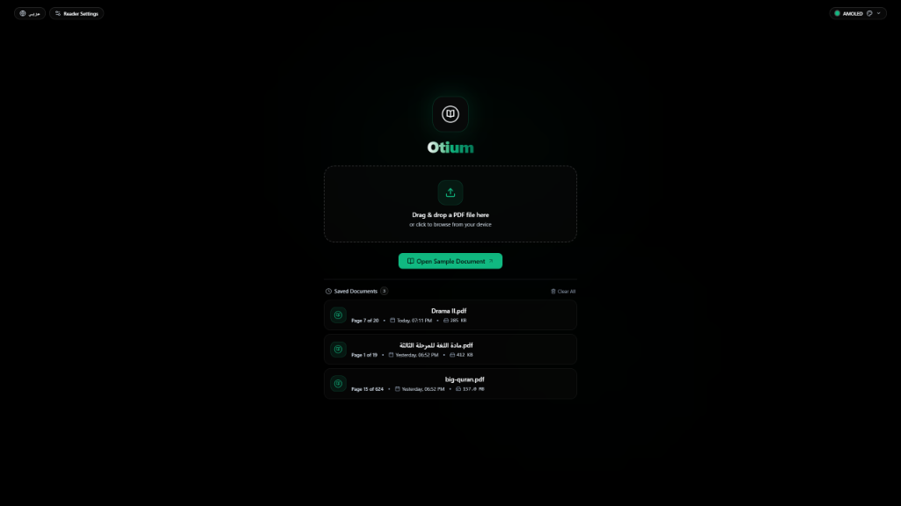
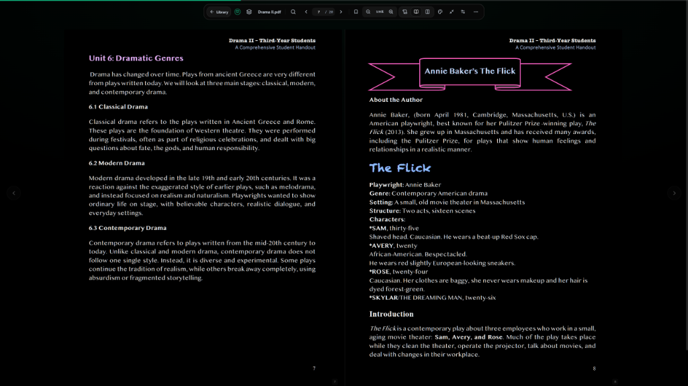
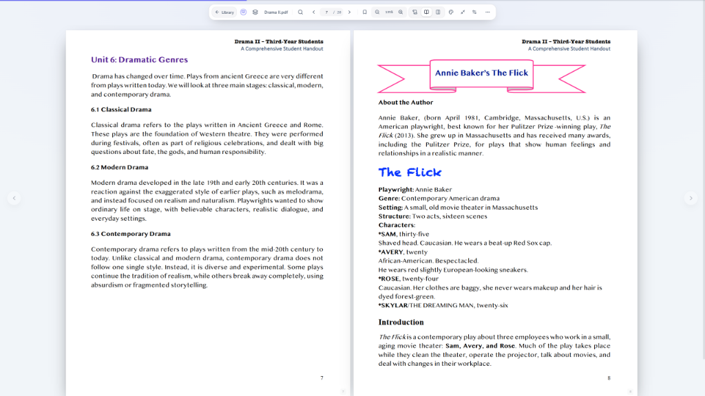

<div align="center">

<a href="https://github.com/XRTM8/Otium">
  
</a>

<br/><br/>

# Otium

<p align="center">
  <em>otium</em> &nbsp;/ˈoː.ti.um/&nbsp; <sup>n. Latin</sup><br/>
  The time set aside for reading, thought, and rest —<br/>
  as opposed to <em>negotium</em>: work, obligation, noise.
</p>

<br/>

<p align="center">
  <a href="https://github.com/XRTM8/Otium/releases/latest">
    
  </a>
  &nbsp;
  
  &nbsp;
  
  &nbsp;
  <a href="LICENSE">
    
  </a>
</p>

<p align="center">
  <a href="#downloads">Downloads</a> &nbsp;·&nbsp;
  <a href="#screenshots">Screenshots</a> &nbsp;·&nbsp;
  <a href="#features">Features</a> &nbsp;·&nbsp;
  <a href="#shortcuts">Shortcuts</a> &nbsp;·&nbsp;
  <a href="#build">Build</a>
</p>

</div>

---

A PDF reader for Windows and Android. No accounts, no telemetry, no internet required after installation. Reading state persists locally across sessions.

The interface is available in **English and Arabic** (RTL layout, full right-to-left navigation).

---

## Screenshots

<div align="center">
  
  <br/><sub>Library</sub>
  <br/><br/>
  
  &nbsp;
  
  <br/><sub>Dual-page spread — dark theme &nbsp;·&nbsp; light theme</sub>
</div>

---

## Downloads

[**GitHub Releases →**](https://github.com/XRTM8/Otium/releases/latest)

| Platform | File | Notes |
| :--- | :--- | :--- |
| Windows — Installer | `Otium_<version>_x64-setup.exe` | Signed; updates automatically |
| Windows — Portable | `Otium_<version>_x64-portable.exe` | No installation required |
| Android | `Otium_<version>_universal.apk` | ARM64, ARMv7, x86\_64 |

**System requirements**

| | Minimum |
| :--- | :--- |
| Windows | 10 (x64) |
| Android | 7.0 (API 24) |

Each release includes `latest.json`, the version feed used by both updaters. The Android APK is SHA-256 verified before the system installer is invoked — no silent sideloading.

---

## Features

**View modes** — Single page, continuous scroll, or dual-page spread with a centre spine divider. Switch modes at any time without reloading the document.

**Themes** — Eight themes (AMOLED black, Midnight Azure, Warm Amber, Pure Amethyst, Ruby Crimson, Natural Paper, Crystal Diamond, E-Ink). Each theme applies consistently to every surface: toolbars, menus, sidebars, dialogs, and the canvas.

**Display** — Detects screen refresh rate (60–240 Hz) automatically. Renders at the full native pixel ratio with sub-pixel antialiasing.

**Android** — Hardware back button navigates step by step (closes modal → closes document → exits library). Safe-area insets clear the status bar and camera notch. Pinch-to-zoom scales the canvas while UI chrome stays fixed. `.pdf` files open directly from the file manager or any sharing source. Text selection, copy, highlight, and underline via long-press.

**Local-first** — No telemetry, no cloud. Bookmarks, annotations, and reading position stored in IndexedDB.

**Architecture** — One codebase, two platform shells:

```
src/core/       engine · search · annotations · bookmarks · i18n · settings
src/platform/   file I/O · updater · runtime detection
src/app/        shared reader controller
src/shells/     DesktopShell · MobileShell
src-tauri/      Rust backend
```

---

## Shortcuts

| Key | Action |
| :---: | :--- |
| `J` / `↓` / `Space` | Next page |
| `K` / `↑` | Previous page |
| `Ctrl+F` | Search |
| `Ctrl+Wheel` | Zoom |
| `T` | Cycle themes |
| `M` | Cycle view modes |
| `F` | Fullscreen |
| `S` | Sidebar |
| `Esc` | Back / close |

---

## Build

**Requirements**

| Tool | Version |
| :--- | :--- |
| Node.js | ≥ 18 |
| Rust | latest stable |
| JDK | 17 *(Android only)* |
| Android SDK + NDK | latest *(Android only)* |

```bash
git clone https://github.com/XRTM8/Otium.git
cd Otium
npm install

# Desktop — development
npm run tauri:dev

# Windows — NSIS installer + portable EXE
# Requires: TAURI_SIGNING_PRIVATE_KEY
npm run tauri:build -- --bundles nsis

# Android — universal APK
# Requires: app/keystore.properties + release keystore
npm run tauri:android

# Verify version consistency across all build inputs
npm run version:check

# Generate latest.json from release-notes.md
npm run release:feed

# Verify hashes and updater signature
node scripts/verify-release.mjs
```

Pushing a `v<version>` tag runs `.github/workflows/release.yml` and produces the Windows installer, portable EXE, and Android APK in a single pipeline.

---

## Contributing

Open an issue before submitting a significant pull request. For bugs, include OS version, app version, and steps to reproduce.

---

## License

GNU General Public License v3.0 — see [`LICENSE`](LICENSE).

<div align="center">
  <br/>
  <sub><a href="https://github.com/XRTM8">XRTM8</a> · GPL-3.0 · 2024–2026</sub>
</div>
